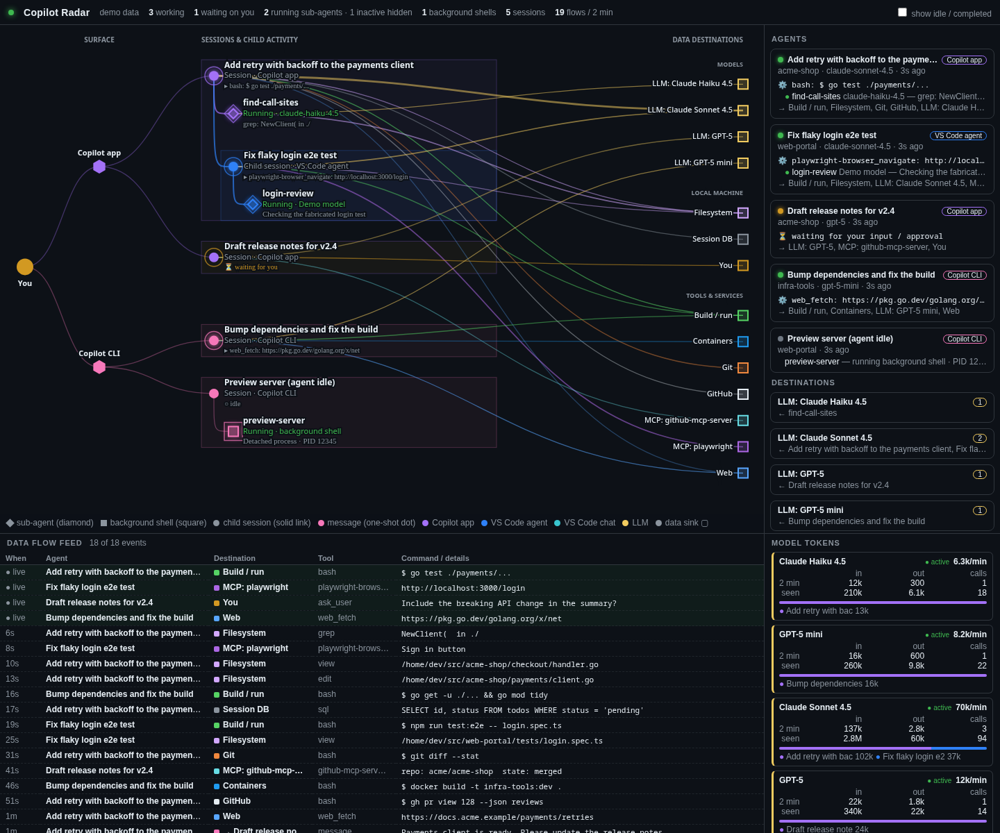
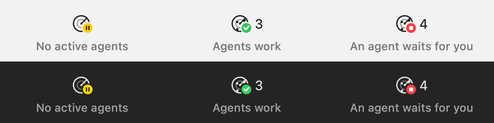
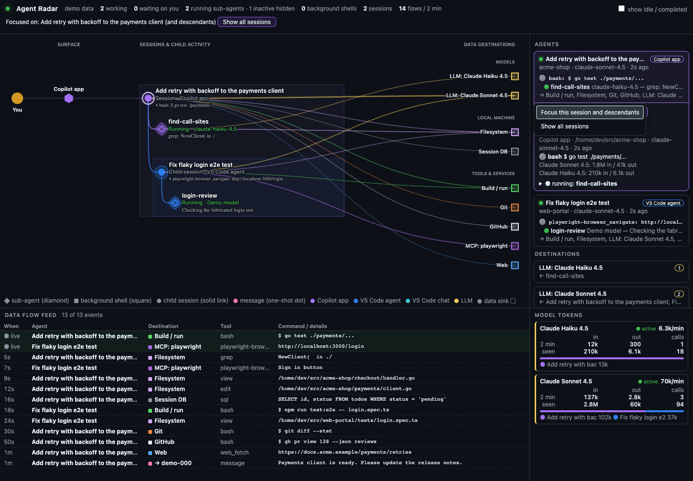

# Agent Radar

Agent Radar shows a live map of the GitHub Copilot agents that run on your computer.
It shows each agent, its sub-agents, the tool that it runs now, and the destinations of its data.



The screenshot shows mock data from the demo mode.

> [!NOTE]
> Agent Radar is a personal open source project.
> It is not an official GitHub product, and GitHub does not support it.
> GitHub and GitHub Copilot are trademarks of GitHub, Inc.

## Download the app

**The app contains everything.** Download it, open it, and the radar starts.

If you use the GitHub Copilot app and do not want a different app, use the [Copilot app extension](#use-the-copilot-app-extension) instead.

| App | Download | Requirements |
|-----|----------|--------------|
| **macOS app** with a menu bar icon | [`Agent-Radar_<version>_macOS.zip`](https://github.com/awlx/agent-radar-app/releases/latest) | macOS 13 or later, Apple silicon or Intel |
| **Windows app** with a tray icon | [`Agent-Radar_<version>_Windows_x64.zip`](https://github.com/awlx/agent-radar-app/releases/latest) or `_Windows_ARM64.zip` | Windows 10 or Windows 11 |

Each app is one file, and the server and the web UI are in this file:

- You do not need Go, a terminal, or a different server.
- You do not need to install the Copilot app or the Copilot CLI. The app reads only the session files that are on the computer.
- The app does not send data to the network. The server listens only on `127.0.0.1`.

### Install the macOS app

1. Download `Agent-Radar_<version>_macOS.zip` from the [latest release](https://github.com/awlx/agent-radar-app/releases/latest).
2. Open the ZIP file and move `Agent Radar.app` to the Applications folder.
3. Remove the quarantine flag with this command:

   ```sh
   xattr -dr com.apple.quarantine "/Applications/Agent Radar.app"
   ```

4. Open the app. The radar icon shows in the menu bar.

The app has an ad hoc signature. Apple did not notarize the app.
Thus, macOS blocks the app at the first start if you do not do step 3.

### Install the Windows app

1. Download `Agent-Radar_<version>_Windows_x64.zip` from the [latest release](https://github.com/awlx/agent-radar-app/releases/latest).
   For a Windows on Arm computer, download `Agent-Radar_<version>_Windows_ARM64.zip`.
2. Extract the ZIP file to a folder, for example `%LOCALAPPDATA%\Programs\Agent Radar`.
3. Open `Agent Radar.exe`.
4. If Microsoft Defender SmartScreen shows "Windows protected your PC", click **More info** and then **Run anyway**.

The app does not have a code signature. Thus, SmartScreen shows a warning at the first start.

Windows 11 can put a new tray icon in the overflow area of the taskbar.
To keep the radar icon on the taskbar, open **Settings > Personalization > Taskbar > Other system tray icons** and set **Agent Radar** to on.

The Windows app shows the radar in a Microsoft Edge WebView2 window. Windows 10 and Windows 11 usually have the WebView2 Runtime.
If the WebView2 Runtime is not available, the app opens the radar in your browser.

### Update from Copilot Radar

The old name of this app was Copilot Radar.

1. Quit Copilot Radar.
2. Install Agent Radar.
3. Open Agent Radar one time. The app copies your settings. On Windows, it also replaces the "Start at Login" entry of the old app.
4. Remove `Copilot Radar.app` or the `Copilot Radar` folder.

## Use the Copilot app extension

The [Agent Radar extension](https://github.com/github/awesome-copilot/tree/main/extensions/agent-radar) in [Awesome Copilot](https://github.com/github/awesome-copilot) shows the radar in a canvas of the GitHub Copilot app.
Use the extension if you use the Copilot app and do not want to install a different app.
The extension does not have a menu bar icon or a tray icon.

The extension needs a version of the GitHub Copilot app that has canvas support.

1. Install the plugin with this command:

   ```sh
   copilot plugin install agent-radar@awesome-copilot
   ```

2. In the Copilot app, open **Canvases**.
3. Open **Agent Radar**.

## Supported products

Agent Radar reads the local session files of these products:

| Product | What the radar shows | Status |
|---------|----------------------|--------|
| [GitHub Copilot app](https://docs.github.com/en/copilot/concepts/copilot-surfaces/github-copilot-app) (desktop app) | The sessions, the sub-agents, the tools, the data flows, and the model tokens. | Supported |
| [GitHub Copilot CLI](https://github.com/github/copilot-cli) | The sessions, the sub-agents, the tools, the data flows, and the model tokens. | Supported |
| Copilot CLI sessions that VS Code starts ("VS Code agent") | The same data as for the Copilot CLI. | Supported |
| [Visual Studio Code](https://code.visualstudio.com) and VS Code Insiders, with GitHub Copilot Chat | The chat sessions, the tools, the data flows, and the model tokens. | Supported |
| Cursor and VSCodium | The chat sessions, if the editor keeps them in the VS Code format. | Not tested |

Agent Radar does not show cloud agents, for example the Copilot coding agent on GitHub.com.
It shows only the agents that run on the same computer.

These operating systems are supported:

| Part | macOS | Windows | Linux |
|------|-------|---------|-------|
| App with a status icon and a window | Yes, macOS 13 or later | Yes, Windows 10 or later | No |
| Command-line tool, server, and web UI | Yes | Yes | Yes |

## Features

- A map of the agents. The map shows the surfaces, the sessions, the sub-agents, and the data destinations.
- Different markers for each type of item:
  - Circle: a session or a child session.
  - Diamond: a sub-agent.
  - Square: a detached background shell.
- Child sessions show below the session that created them.
- A moving dot shows each new message between sessions.
- A live feed of the data flows, with the tool and the command of each flow.
- The model tokens for each model. This includes models that you configure with your own key (BYOK).
- A side panel with the details of the selected item. In the app, the details of a session have a **Show app** button.
- Session context actions to focus the radar on one session and its descendants, or show the session's app.
- A status icon in the macOS menu bar or in the Windows notification area.
- A JSON summary for scripts and for AI agents.

If the operating system is set to reduce motion, the UI does not show animations.

For more information about the map, the destinations, and the background shells, refer to [How Agent Radar works](docs/how-it-works.md).

## Use the app

The macOS app and the Windows app have the same functions.

### Status icon



The status icon shows the status of the agents with a badge in a color:

| Badge | Status |
|-------|--------|
| Yellow pause | No agent is active. |
| Green check mark | One or more agents work, and no agent waits for you. |
| Red stop | One or more agents wait for your input. |

The icon does not move. The dots on the radar show the number of active agents.
On macOS, the number of active agents is also next to the icon.
On Windows, move the pointer to the icon to see the number of active agents.

### Menu

To open the menu, click the icon on macOS. On Windows, right-click the icon.
On Windows, a click with the left mouse button shows the radar window.

The menu shows these sections:

- **Waiting for you**: the sessions that wait for your input. Click a session to show its app.
- **Models in use**: the models of the active agents, with the number of agents and the tokens of the last 2 minutes.

A click on a session that waits shows the related app:

- A Copilot app session opens in the Copilot app.
- A VS Code chat opens the folder of the chat in its editor. This shows the correct editor window.
- A VS Code agent session opens the closest workspace folder that contains the folder of the session, in its editor.
- For a multi-root window, the editor opens the saved `.code-workspace` file of the window instead. If you did not save the workspace, the editor only comes to the front, because a folder of the window would open in a new window.
- A Copilot CLI session shows the terminal app that runs the CLI. On macOS, a different window of that app can be in front.

In the radar window, click a session to show its details. The **Show app** button in the details shows the app of the session in the same way.
The button is only in the app. It is not available in `-demo` mode or with a LAN address.

### Focus a session

Right-click a session in the graph or the sidebar and choose **Focus this session and descendants**.
In the sidebar, you can also press Shift-F10 or the context-menu key on a session card.
The session details have the same focus action, so a context menu is not required.
An ordinary click still selects the session without filtering the radar or switching apps.

The focused view includes the session, its nested child sessions, sub-agents, background shells,
and data destinations. The graph, sidebar, counters, activity feed, and model totals all use this scope.
New child sessions appear as the radar updates. Messages to other sessions do not pull those sessions into the view.
Model totals still include the idle session history within the scope; **show idle / completed** controls which
descendants and completed sub-agents are visible. The focused root stays visible even when idle.

The header names the focused session. Choose **Show all sessions** to return to the full live view.
If the session disappears, the radar shows that it is no longer available rather than silently switching back.
Focus lasts for the current page; reloading the page restores the full view.

The context menu also has **Show app** when the native app can show that session, using the same
behavior and restrictions as the details button. Use the arrow keys to navigate the menu,
Enter or Space to choose an action, and Escape to dismiss it.

For Copilot app sessions, **Show app** opens `ghapp://sessions/<sessionId>` through the operating system,
which can launch the registered Copilot app if needed. It never creates a new session.
The app must be installed and its protocol handler registered. Accepting a launch request does not
guarantee that the target session exists or that the operating system brings the correct window to the front.
VS Code navigation targets the owning folder or workspace, not a particular chat.
CLI navigation is best-effort terminal-app/window focus, not exact terminal-tab selection.



### Other menu commands

The menu also has these commands:

| Command | Function |
|---------|----------|
| Show Radar | Shows the radar window. |
| Stay in Foreground | Keeps the radar window above the windows of other apps. |
| Open in Browser | Opens the radar in your browser. |
| Start at Login | Windows only. Starts the app with the tray icon only when you log in. |
| Quit Agent Radar | Stops the app and its server. |

On macOS, "Stay in Foreground" also shows the window on all desktops.
On macOS, you can also set this mode with the pin button in the title bar of the window, or with Shift-Command-T.
The app keeps this mode when you start it again.

When you close the window, the app continues to run with its status icon.
The app uses the port 47900. If a different program uses this port, the app uses a free port.

## Command-line tool and server

The command-line tool `agent-radar` is for Linux, for computers without a desktop, for LAN access, and for scripts.
It has the same server and web UI as the apps.
If you use the macOS app or the Windows app, you do not need the command-line tool.

### Download the command-line tool

Each [release](https://github.com/awlx/agent-radar-app/releases) also has these files:

| File | Contents |
|------|----------|
| `agent-radar-cli_<version>_darwin_universal.tar.gz` | The command for macOS. |
| `agent-radar-cli_<version>_linux_<arch>.tar.gz` | The command for Linux on `amd64` or `arm64`. |
| `agent-radar-cli_<version>_windows_<arch>.zip` | The command for Windows on `amd64` or `arm64`. |
| `checksums.txt` | The SHA-256 checksums of all the files. |

### Install with Go

You must have Go 1.22 or a later version.

```sh
go install github.com/awlx/agent-radar-app/cmd/agent-radar@latest
```

To build from the source, use these commands:

```sh
git clone https://github.com/awlx/agent-radar-app
cd agent-radar-app
go build -o agent-radar ./cmd/agent-radar
```

### Start the server

```sh
agent-radar
```

Then open http://127.0.0.1:47900 in a browser.

To see the UI with mock data, use `agent-radar -demo`.
The demo mode does not read your session files.

| Flag | Default | Description |
|------|---------|-------------|
| `-listen` | `127.0.0.1:47900` | The address and port for the server. |
| `-token` | random | The access token for a LAN address. You can also set `AGENT_RADAR_TOKEN`. The old name `COPILOT_RADAR_TOKEN` also works. |
| `-no-auth` | `false` | Disable the token check on a LAN address. |
| `-poll` | `2s` | The interval between two reads of the session logs. |
| `-snapshot` | `false` | Print a JSON summary of the active agents and stop. |
| `-all` | `false` | With `-snapshot`, include the idle sessions. |
| `-demo` | `false` | Show mock agents. Use this mode for screenshots. |
| `-version` | `false` | Print the version and stop. |
| `-app` | `false` | Show the radar in a window with a status icon. This flag needs macOS or Windows. |
| `-background` | `false` | With the app, start with the status icon only, without the window. |

The apps accept the same flags. For example, `"Agent Radar.exe" -demo` starts the Windows app with mock data.

### LAN access

By default, the server listens only on 127.0.0.1. Other computers cannot connect.

To show the radar on the LAN, use this command:

```sh
agent-radar -listen 0.0.0.0:47900
```

The server makes a random token and prints the URLs with the token. Open one URL with the token one time. The browser then keeps the token in a cookie. A script can also send the header `Authorization: Bearer <token>`.

WARNING: The radar shows your session names, file paths, and full shell commands. Do not use `-no-auth` on a network that you do not trust.

CAUTION: LAN mode uses plain HTTP. Other hosts on the same network can read the token and the data. For a remote view, use an SSH tunnel or a VPN.

## Privacy

`agent-radar` reads only local files. It does not send requests to the network.

`agent-radar` reads these files:

- `$COPILOT_HOME/session-state/*/events.jsonl`, `workspace.yaml`, and the `inuse.*.lock` files.
- `$COPILOT_HOME/ide/*.lock`.
- For VS Code, VS Code Insiders, Cursor, and VSCodium, in the folder of each product in the application-data folder:
  - `User/workspaceStorage/*/chatSessions/*` and `User/workspaceStorage/*/workspace.json`.
  - The `.code-workspace` file of a multi-root window, to find its folders.
  - `User/globalStorage/emptyWindowChatSessions/*`.

The default value of `$COPILOT_HOME` is `~/.copilot`.

The application-data folder is:

- `$VSCODE_APPDATA`, if you set this variable.
- On Windows: `%APPDATA%`. If `APPDATA` is not set, `~/AppData/Roaming`.
- On macOS: `~/Library/Application Support`.
- On Linux: `$XDG_CONFIG_HOME`. If `XDG_CONFIG_HOME` is not set, `~/.config`.

The server listens on the address that you give with `-listen`. A LAN address needs the access token.

The `/api/snapshot` endpoint and the `-snapshot` output contain session data.
This data includes session names, folders, repositories, tool names, and data destinations.
The summary does not contain command arguments, because arguments can contain credentials.
The `/state` and `/events` endpoints contain the full commands for the UI.
Do not give the output of these endpoints to other persons or to an AI model.

## HTTP endpoints

| Path | Description |
|------|-------------|
| `/` | The UI. |
| `/state` | The full snapshot as JSON. |
| `/events` | The snapshot as server-sent events. |
| `/api/snapshot` | A short JSON summary of the active agents. Add `?all=1` to include idle sessions. |
| `/api/jump?session=<id>` | `POST` only. Shows the app of a session. Only the app has this path, and only on a loopback address. |
| `/healthz` | A health check. This path does not need a token. |

## Project layout

| Folder | Contents |
|--------|----------|
| `cmd/agent-radar` | The command and its flags. |
| `internal/collector` | The code that reads the session files of each product. |
| `internal/server` | The HTTP server, the server-sent events, and the web UI. |
| `internal/tray` | The macOS app, the Windows app, and the status icon. |
| `internal/demo` | The mock data for `-demo`. |
| `macos` | The `Info.plist` file, the icon generator, and the build script of the macOS app. |
| `windows` | The build script of the Windows app. |
| `scripts` | The script that builds the release files. |
| `docs` | More documentation. |
| `docs/images` | The screenshots. |

## Development

```sh
go vet ./...
go test ./...
```

To build the macOS app, run `./macos/build-app.sh` on a Mac with the Xcode command line tools.
The script makes `dist/Agent Radar.app`.

To build the Windows app, run `./windows/build-app.sh`. You can run this script on macOS, Linux, or Windows.
The script makes `dist/windows/amd64/Agent Radar.exe` and `dist/windows/arm64/Agent Radar.exe`.
The build does not need cgo.

To make new screenshots, start `agent-radar -demo` and use a browser at a width of 1440 pixels.
Do not make screenshots with real session data, because the data can contain private names and paths.

To make a release, push a tag that starts with `v`, for example `v0.2.0`.
The release workflow builds the files with `scripts/release.sh` and publishes the release.

Refer to [CONTRIBUTING.md](CONTRIBUTING.md) and [SECURITY.md](SECURITY.md).

## License

Agent Radar has the MIT license. Refer to [LICENSE](LICENSE).
